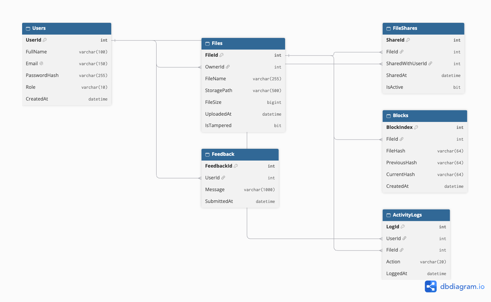

# Database and Admin Module (Person 1)

## 1. Overview
The system stores its data in a Microsoft SQL Server database named `BlockchainFileShare`. The database holds user accounts, file details, sharing records, activity logs, feedback and the blockchain of file hashes. The uploaded files themselves are not stored in the database. They are saved on the server in encrypted form, and the database stores only the path to each file.

## 2. Tables

| Table | Purpose |
|---|---|
| Users | Registered users and admins. Stores name, email, password hash and role (User or Admin). |
| Files | Details of every uploaded file: owner, file name, storage path, size, upload time and a tamper flag (IsTampered). |
| FileShares | Records which file is shared with which user. IsActive is set to 0 when access is revoked. |
| ActivityLogs | Records every file view and download with the user, file and time. |
| Feedback | Experience and suggestions sent by users. |
| Blocks | The blockchain. Each block stores a file hash, the previous block's hash and its own hash. |

## 3. Relationships
- One user can own many files (Files.OwnerId references Users.UserId).
- A file can be shared with many users, and a user can receive many files. FileShares links the two tables.
- ActivityLogs references both Users and Files, so each log says who did what to which file.
- Feedback references Users, so each message is linked to its sender.
- Each uploaded file has a block in Blocks (Blocks.FileId references Files.FileId).

The ER diagram is in `ER-diagram.png`.

## 4. Data Integrity Rules
- Primary keys uniquely identify each row, and IDs are generated automatically.
- Foreign keys stop a record from pointing to a user or file that does not exist.
- Email is unique, so two accounts cannot share one email.
- CHECK rules allow only valid values: Role must be User or Admin, and Action must be View or Download.
- Default values fill in dates, the starting role and the tamper flag automatically.

## 5. Admin Module
The admin module has five pages.
1. **Admin login:** the entered password is hashed with SHA-256 and compared with the stored hash. Only accounts with Role = Admin are accepted. A session remembers the login.
2. **All users:** lists every registered user with name, email, role and registration date. Password hashes are never shown.
3. **Tampered files:** lists files where IsTampered = 1, with the owner's name. The flag is set by the blockchain verification.
4. **Activity logs:** lists every view and download, newest first, by joining ActivityLogs with Users and Files.
5. **User feedback:** lists all feedback with the sender's name, newest first.

## 6. Security Measures
- Passwords are stored only as hashes, never as plain text.
- All database queries use parameters, which prevents SQL injection.
- Every admin page checks the session first, so the pages cannot be opened without logging in.
- Page output is HTML-encoded, which prevents cross-site scripting (XSS).
- The database password is kept in a git-ignored settings file, so it is never published to GitHub.
